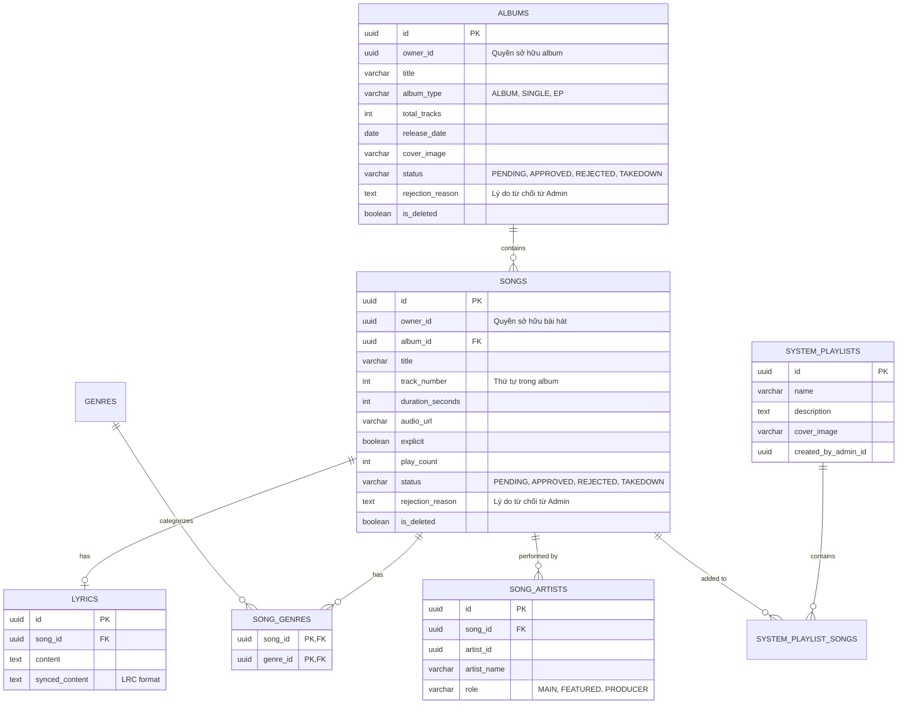

# Phân tích Yêu cầu và Kiến trúc Database (Catalog Service)

Dựa trên cấu trúc mở rộng của `mc_music_catalog_schema`, cơ sở dữ liệu đã được hoàn thiện để đáp ứng đầy đủ nghiệp vụ của một ứng dụng nghe nhạc trực tuyến chuyên nghiệp (như Spotify, Apple Music). Dưới đây là phân tích chi tiết về các tính năng, API tương ứng và cấu trúc Database chuẩn mực hiện tại.

---

## 1. Phân tích Chức năng Dưới góc độ Người dùng (User-facing Features)

Để mang lại trải nghiệm nghe nhạc toàn diện, hệ thống hỗ trợ 3 nhóm đối tượng:

### 1.1. Khám phá & Tìm kiếm (Discovery & Search - User)
- **Tìm kiếm đa năng (Global Search):** Tìm kiếm theo tên bài hát, tên album, tên nghệ sĩ hoặc thậm chí là một đoạn lời bài hát.
- **Khám phá theo danh mục:** Duyệt nhạc theo Thể loại (Pop, Rock, Indie), Tâm trạng, hoặc Quốc gia.
- **Bảng xếp hạng (Charts):** Top bài hát nhiều lượt nghe nhất (`trending`).
- **Playlist do hệ thống quản lý (Editorial Playlists):** Các playlist do admin tạo ra (`system_playlists`).

### 1.2. Trải nghiệm Nghe nhạc (Playback - User)
- **Hiển thị Lời bài hát (Lyrics):** Lời bài hát tĩnh hoặc lời bài hát chạy chữ đồng bộ với nhạc (karaoke/synced lyrics qua chuẩn LRC).
- **Thứ tự bài hát trong Album:** Phát chuẩn xác theo tracklist của một album (`track_number`).
- **Nghệ sĩ hợp tác (Feat.):** Thấy rõ các nghệ sĩ cùng góp giọng trong một bài hát qua bảng `song_artists`.

### 1.3. Hồ sơ & Quản trị Nội dung (Artist & Admin)
- **Trang Nghệ sĩ:** Tải lên bài hát/album mới (trạng thái mặc định `PENDING`), gán lyrics, mời nghệ sĩ hợp tác (feat).
- **Xem lý do từ chối:** Nếu nội dung bị từ chối (`REJECTED`) hoặc gỡ bỏ (`TAKEDOWN`), nghệ sĩ có thể đọc trực tiếp lý do và ghi chú vi phạm (`rejection_reason`) do Admin gửi về.
- **Trang Quản trị:** Duyệt bài hát/album sang `APPROVED`, hoặc từ chối kèm lý do theo Bộ quy tắc kiểm duyệt chuẩn hóa.

---

## 2. Cấu trúc Database Hiện tại (`mc_music_catalog_schema`)

### 2.1. Bảng `albums`
- `id`: `UUID` (Primary Key)
- `owner_id`: `UUID` (Nghệ sĩ sở hữu)
- `owner_name`: `VARCHAR(255)` (Tên nghệ sĩ nhân bản)
- `title`: `VARCHAR(255)`
- `album_type`: `VARCHAR(20)` ('ALBUM', 'SINGLE', 'EP')
- `total_tracks`: `INT`
- `description`: `TEXT`
- `cover_image`: `VARCHAR(500)`
- `release_date`: `DATE`
- `status`: `VARCHAR(50)` ('PENDING', 'APPROVED', 'REJECTED', 'TAKEDOWN')
- `rejection_reason`: `TEXT` (Lý do từ chối duyệt hoặc gỡ album từ Admin)
- `like_count`: `INT`
- `is_deleted`: `BOOLEAN` (Xóa mềm)
- `created_at`: `TIMESTAMP`

### 2.2. Bảng `songs`
- `id`: `UUID` (Primary Key)
- `owner_id`: `UUID` (Nghệ sĩ sở hữu ca khúc)
- `owner_name`: `VARCHAR(255)` (Tên nghệ sĩ nhân bản)
- `album_id`: `UUID` (FK liên kết tới `albums`, cho phép NULL với single độc lập)
- `title`: `VARCHAR(255)`
- `track_number`: `INT` (Thứ tự bài hát trong album)
- `duration_seconds`: `INT`
- `audio_url`: `VARCHAR(1000)` (URL stream nhạc từ Cloudinary)
- `audio_public_id`: `VARCHAR(255)` (ID quản lý tài nguyên trên Cloudinary)
- `cover_image`: `VARCHAR(500)`
- `explicit`: `BOOLEAN` (Đánh dấu ca từ nhạy cảm)
- `play_count`: `INT`
- `like_count`: `INT`
- `status`: `VARCHAR(50)` ('PENDING', 'APPROVED', 'REJECTED', 'TAKEDOWN')
- `rejection_reason`: `TEXT` (Lý do từ chối duyệt hoặc gỡ bài hát từ Admin)
- `is_deleted`: `BOOLEAN` (Xóa mềm)
- `created_at`: `TIMESTAMP`

### 2.3. Bảng `song_artists` (Quan hệ nhiều - nhiều giữa Ca khúc và Nghệ sĩ hợp tác)
- `id`: `UUID` (Primary Key)
- `song_id`: `UUID` (FK `songs.id`)
- `artist_id`: `UUID` (ID nghệ sĩ)
- `artist_name`: `VARCHAR(255)` (Denormalized)
- `role`: `VARCHAR(50)` ('MAIN', 'FEATURED', 'PRODUCER')
- *Ràng buộc UNIQUE (song_id, artist_id)*

### 2.4. Bảng `lyrics` (Lời bài hát tách riêng)
- `id`: `UUID` (Primary Key)
- `song_id`: `UUID` (FK UNIQUE `songs.id`)
- `content`: `TEXT` (Lời bài hát plain text)
- `synced_content`: `TEXT` (Lời bài hát định dạng LRC có timestamp karaoke)
- `language`: `VARCHAR(10)`

### 2.5. Bảng `song_genres` (Quan hệ nhiều - nhiều giữa Ca khúc và Thể loại)
- `song_id`: `UUID` (FK `songs.id`)
- `genre_id`: `UUID` (FK `genres.id`)
- *Primary Key (song_id, genre_id)*

### 2.6. Bảng `system_playlists` và `system_playlist_songs`
- **`system_playlists`**: `id`, `name`, `description`, `cover_image`, `created_by_admin_id`, `created_at`
- **`system_playlist_songs`**: `id`, `playlist_id`, `song_id`, `position_order`, `added_at`

---

## 3. Lược đồ Thực thể Liên kết (ERD Toàn diện)

